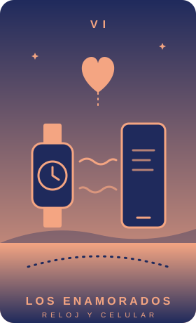

<p align="center"></p>

# VI · Los Enamorados

App Android que **habla directo con el smartwatch**, sin pasar por la app del fabricante. Funciona con los relojes genéricos que se usan con **HryFine** (`com.lianhezhuli.hyfit`): el reloj «Smartwatch» del proyecto Arcanos (firmware V2.2, dirección BLE `41:42:CE:02:D5:6C`).

Es la carta VI del mazo: el celular y el reloj, conversando.

## Qué hace (versión 0.3, experimental)

La pantalla, de arriba abajo:

- **Reloj**: estado, batería, datos del fabricante y «Conectar». Encuentra el reloj por Bluetooth de baja energía: primero los aparatos «conectados ahora» (si HryFine está conectado, el reloj deja de anunciarse, pero se le puede hablar por el mismo enlace), luego los emparejados y los que encuentre cerca (★ = anuncia el canal de HryFine).
- **Clima**: temperatura de ahora, estado (con ícono), mínima y máxima de hoy de la ciudad elegida (por defecto Bogotá; «Cambiar ciudad», sin pedir ubicación). Fuente: [Open-Meteo](https://open-meteo.com) (gratis, sin clave). **Se envía solo al reloj** al conectar y luego cada 3 horas mientras siga conectado; también con «Enviar al reloj». En el reloj aparece en su pantalla de clima (deslizando) o en las esferas que lo muestran.
- **Salud**, en lenguaje sencillo:
  - Resumen en una línea: «Hoy: 2.645 pasos · último pulso 83 lpm (normal en reposo) · presión 112/73 (normal)».
  - **Presión** con su categoría de la guía AHA/ACC 2017 en color (normal, elevada, alta etapa 1, alta etapa 2, crisis; y «baja» si es menos de 90/60) y qué significa cada número: la alta (sistólica) es la presión cuando el corazón late; la baja (diastólica), cuando descansa.
  - **Pulso**: menos de 60 bajo, 60–100 normal, más de 100 alto («si estabas en reposo»).
  - **Zonas de cardio**: con la edad (y, si se quiere, el pulso en reposo) calcula el pulso máximo (Tanaka: 208 − 0,7 × edad) y las 5 zonas en latidos por minuto (Z1 50–60 % muy suave … Z5 90–100 % máxima), con una barra que marca dónde cae el último pulso. Con pulso en reposo usa el método de Karvonen.
  - Pasos, distancia y calorías (por confirmar) del reloj; botones para medir pulso, presión y oxígeno (este último aún no responde). Orientativo, no sirve para diagnóstico.
- **Usar el reloj**: vibrar para encontrarlo (un pulso o 5 s), poner la hora del celular, y el interruptor de los **botones de música** (en la pantalla de música del reloj, «anterior», «siguiente» y «pausa» controlan la música del celular).
- **Herramientas avanzadas (para Claude)**, plegadas: sirven para que Claude pruebe órdenes nuevas en el reloj y vea lo que responde. Mensaje y llamada de prueba, clima a mano, «Enviar una orden en código (avanzado)» (arma cualquier trama del protocolo), datos de mediciones sin descifrar y la consola (→ enviado, ← recibido; «Copiar» la deja lista para pegársela a Claude).
- **Registro**: como las demás apps de los Arcanos, mantener presionado el ícono → «Enviar registro».

## Cómo usarla

1. Instala el APK: [los-enamorados.apk](https://github.com/davidsant7e/los-enamorados-android/releases/download/ultima/los-enamorados.apk) (se compila solo en GitHub) o con `C:\Git\compilar-todo.bat`.
2. Ábrela y da el permiso de **Dispositivos cercanos**.
3. Elige el reloj (o escribe `41:42:CE:02:D5:6C`). **No lo vincules en los ajustes de Bluetooth del celular**: si Android lo vincula, mezcla la dirección de datos con la de llamadas y después ninguna app logra reconectar (error 147). Si pasa, «Olvidar» el Smartwatch en Ajustes y elegirlo otra vez en la app. La app recuerda tu elección y se conecta sola al abrirla.
4. Prueba **Vibrar**. Si el reloj vibra, el canal funciona. El clima se envía solo al conectar.

**HryFine puede quedarse instalado.** Android permite que dos apps hablen con el mismo reloj. Si algo no responde, cierra HryFine (Ajustes → Apps → HryFine → Forzar detención) y vuelve a conectar.

**Si se corta** (por ejemplo cuando HryFine sincroniza y Android cierra el enlace), la app no se rinde: queda en «Esperando al reloj…» y se reconecta sola en cuanto el reloj queda libre, sin el límite de 30 s que daba el código 147. «Cancelar» detiene la espera.

## El protocolo

Ingeniería inversa publicada por [jsphu/polosmart-pbs163-ble](https://github.com/jsphu/polosmart-pbs163-ble) (licencia MIT), a partir del APK de HryFine y de capturas Bluetooth. Detalle en `app/src/main/java/com/davidsant7e/enamorados/protocolo/Protocolo.kt`.

- Canal: Nordic UART con el último byte cambiado — servicio `6E400001-B5A3-F393-E0A9-E50E24DCCA9F`, RX `…0002…` (escribir), TX `…0003…` (avisos).
- Trama del celular: `DF | largo (2) | suma | categoría | 01 | subcomando | largo datos (2) | datos`, con `largo = datos + 5` y la suma de todos los demás bytes en la posición 3.
- Respuesta del reloj: `FD | largo | suma | categoría | subcomando | estado` (termina en `01` si salió bien).
- Comandos usados (categoría `02`): `01` hora, `0B` vibrar, `0C` interruptores de avisos, `11` llamada, `12` mensaje, `1A` 12/24 h, `1B` unidades, `1D` clima. Botones de música: categoría `0C`; el Smartwatch manda `02` (pausa), `03` (anterior) y `04` (siguiente), el PBS163 `0A`–`0D`.
- Clima `02/1D`: `año (2) | mes | día | 00 | estado | mínima | máxima | actual | ciudad`, estado 0 soleado, 1 nublado, 2 cubierto, 3 lluvia, 4 tormenta, 5 nieve, 6 niebla. Es solo el día de hoy: el protocolo publicado no trae formato de pronóstico de varios días (el `00` tras la fecha no tiene función conocida). La app traduce los códigos WMO de Open-Meteo a esos 7 estados.
- **Probado con el Smartwatch el 24 nov 2026**: el reloj respondió «bien» a vibrar, hora, clima, interruptores, mensaje, llamada y colgar. Servicios: `180F`, `180A`, `FF00`, `FF10`, `FF12` y el canal `6E400001…9F`; MTU 256.
- La pantalla muestra unos 42 caracteres en 3 líneas, sin emojis; el byte `00` corta el texto (la app los limpia).

Ese trabajo se hizo con otro reloj de la misma familia (Polosmart PBS163). Este «Smartwatch» trae además llamadas por Bluetooth clásico, así que puede entender comandos de más o de menos: la consola existe para averiguarlo.

## Pruebas

```bash
./gradlew testDebugUnitTest
```

Prueban el armado de tramas (con valores calculados aparte), la hora empaquetada, la limpieza del texto, el partido de tramas largas, la lectura de respuestas y eventos que llegan en trozos, los datos de salud, las categorías de presión y pulso en sus límites (119/79, 120/80, 130/80, 140/90, 181/121, 89/59), las zonas de cardio para varias edades, y la lectura de las respuestas de Open-Meteo con el paso de los códigos del tiempo WMO al clima del reloj (`salud/Explicar.kt`, `clima/OpenMeteo.kt`, `clima/Json.kt`: funciones puras).

## Proyecto

- Kotlin, Jetpack Compose, minSdk 26, compileSdk 37. Sin librerías de Bluetooth externas.
- Paquete `com.davidsant7e.enamorados`. Firma de prueba compartida (`firma/`), igual que las demás apps.
- Parte del mazo de los Arcanos: [davidsant7e](https://github.com/davidsant7e).
